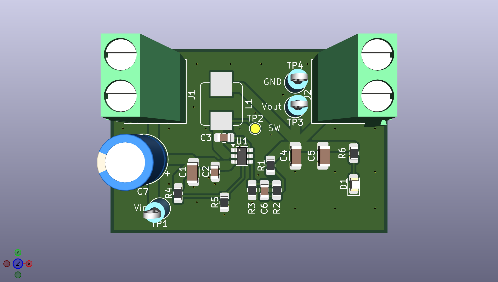
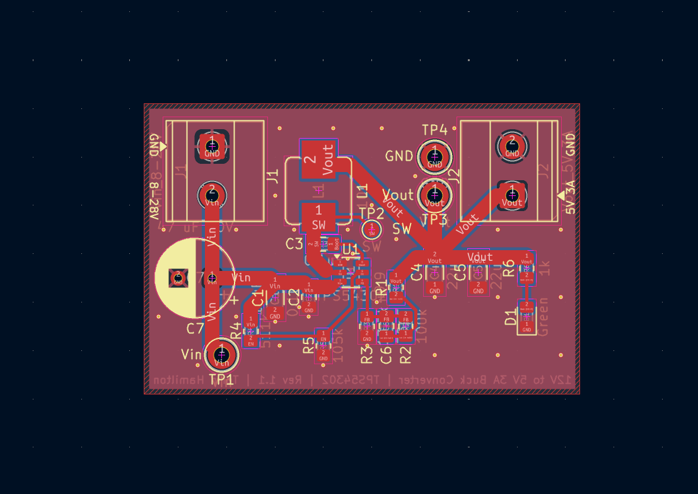
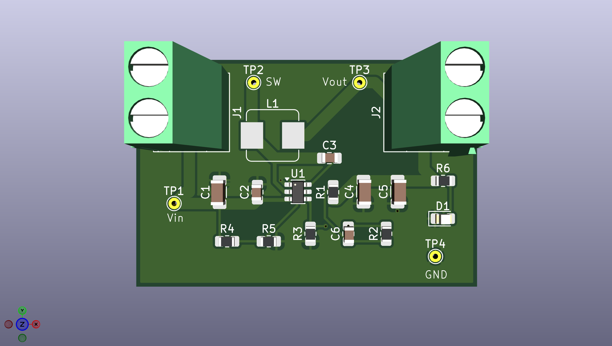
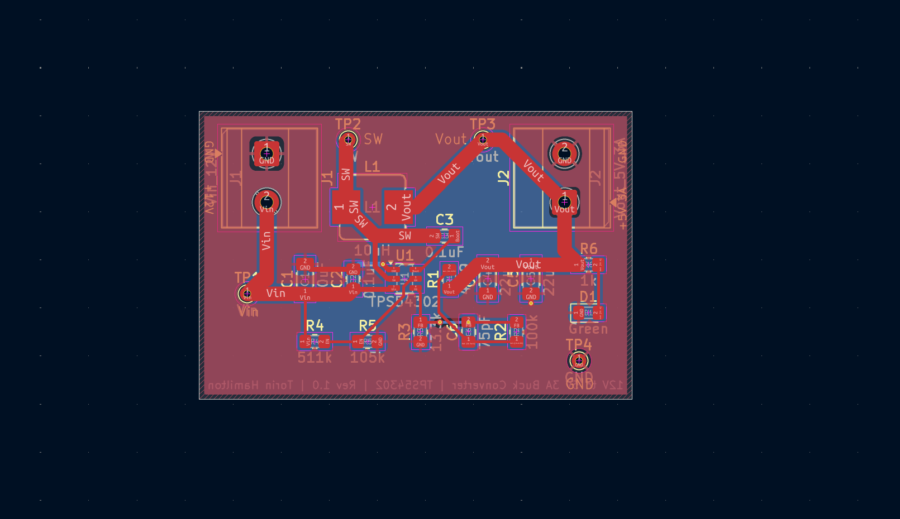

# 12V-to-5V 3A Synchronous DC-DC Buck Converter (TPS54302)

**Author:** Torin Hamilton  
**CAD Tool:** KiCad 10.0  
**Topology:** Fixed-Frequency ($400\text{ kHz}$) Peak-Current-Mode Synchronous Buck Converter  
**Board Dimensions:** $45\text{ mm} \times 30\text{ mm}$, 2-Layer FR-4 ($1.6\text{ mm}$ thickness, $1\text{ oz}$ copper)

*Rev 1.1 (3D render).*

*Rev 1.1 (2D layout).*

Rev 1.0 renders (first PCB, as fabricated)

## Revision History

| Rev | Status | Summary |
| :-: | :--- | :--- |
| **1.0** | PCBs and components ordered; awaiting assembly and bring-up | First PCB design. Component values follow TI's 5 V, 3 A reference design (Datasheet Figure 7-1). Post-layout review findings are documented in [Section 6](#6-known-issues--rev-11-changes). |
| **1.1** | PCBs ordered from OSH Park and components ordered from Mouser (Nov 2026); awaiting assembly and bring-up | Addresses all eight Rev 1.0 issues in [Section 6](#6-known-issues--rev-11-changes): shortened input hot loop with dedicated `GND` vias, solid SMD ground connections and 32 `GND` stitching vias, input damping capacitor `C7`, compact feedback network, extended `L1` pad, reduced `SW` copper, and Keystone-compatible test points. |

---

## 1. Project Overview

This project implements a compact, high-efficiency **12V-to-5V, 3A Synchronous Step-Down (Buck) DC-DC Converter** based on the Texas Instruments **`TPS54302`** (`SOT-23-6`). It is designed for 12V/24V distributed power buses, embedded systems, and benchtop prototyping, with all surface-mount and through-hole footprints selected and spaced for reliable hand-soldering and oscilloscope characterization.

### Key Electrical Specifications

| Parameter | Symbol | Value | Notes |
| :--- | :---: | :---: | :--- |
| **Input Voltage Range** | $V_{\text{IN}}$ | $8\text{ V} \text{ to } 28\text{ V}$ | Optimized for $12\text{ V}$ nominal; matches TI reference design (Datasheet Table 7-1) |
| **Output Voltage** | $V_{\text{OUT}}$ | $5.08\text{ V}$ ($5.0\text{ V}$ nom) | Set by $1\%$ feedback divider ($R_2, R_3$); $\approx 4.9\text{ -- } 5.25\text{ V}$ worst case over $V_{\text{ref}}$ ($0.581\text{ -- }0.611\text{ V}$) and resistor tolerance |
| **Max Continuous Output Current** | $I_{\text{OUT(MAX)}}$ | $3.0\text{ A}$ | Integrated $85\text{ m}\Omega$ HS / $40\text{ m}\Omega$ LS MOSFETs |
| **Switching Frequency** | $f_{\text{SW}}$ | $400\text{ kHz}$ | With $\pm 6\%$ frequency spread-spectrum for EMI reduction |
| **Peak Efficiency** | $\eta$ | $\approx 93\% \text{ -- } 95\%$ | At $V_{\text{IN}} = 12\text{ V}, V_{\text{OUT}} = 5\text{ V}$ |
| **Output Voltage Ripple** | $\Delta V_{\text{OUT}}$ | $< 30\text{ mV}_{\text{PP}}$ | Low-ESR MLCC output filter ($2 \times 22\,\mu\text{F}$) |
| **Transient Response ($1.5\text{ A}$ step)** | $\Delta V_{\text{TR}}$ | $< \pm 5\%$ ($\pm 250\text{ mV}$) | Phase-margin boosted via $75\text{ pF}$ feedforward cap |

### Repository Contents
- **[fab/rev1.0/](fab/rev1.0/)** — Rev 1.0 fabrication snapshot, exactly as ordered:
  - [Schematic PDF](fab/rev1.0/12V_5V_Buck_Converter_rev1.0_schematic.pdf) with engineering callouts
  - [Gerber & drill package (.zip)](fab/rev1.0/12V_5V_Buck_Converter_rev1.0_gerbers.zip) and [individual files](fab/rev1.0/gerbers/) (RS-274X Gerbers, Excellon drill)
  - [BOM as ordered](fab/rev1.0/12V_5V_Buck_Converter_rev1.0_BOM.xlsx)
- **[fab/rev1.1/](fab/rev1.1/)** — Rev 1.1 fabrication package:
  - [Schematic PDF](fab/rev1.1/12V_5V_Buck_Converter_rev1.1_schematic.pdf)
  - [Gerber & drill package (.zip)](fab/rev1.1/12V_5V_Buck_Converter_rev1.1_gerbers.zip) and [individual files](fab/rev1.1/gerbers/) (RS-274X Gerbers, Excellon drill)
  - [BOM](fab/rev1.1/12V_5V_Buck_Converter_rev1.1_BOM.xlsx)
- **KiCad source (always the latest revision; currently Rev 1.1):**
  - [12V_5V_Buck_Converter.kicad_sch](12V_5V_Buck_Converter.kicad_sch): KiCad 10 schematic (Rev 1.0 passed with 0 ERC violations)
  - [12V_5V_Buck_Converter.kicad_pcb](12V_5V_Buck_Converter.kicad_pcb): KiCad 10 2-layer PCB layout (0 DRC violations)
  - [Library.pretty/](Library.pretty/) + [fp-lib-table](fp-lib-table): project footprint library (`L1` extended-pad footprint)
- **[BOM.xlsx](BOM.xlsx)** — Current (Rev 1.1) orderable Bill of Materials with Manufacturer Part Numbers; the Rev 1.0 order record is kept on a separate sheet
- **[images/](images/)** — PCB renders, named by revision
- **[docs/](docs/)** — Reference datasheets (TI TPS54302)

---

## 2. Engineering Design & Component Calculations

All component values are derived from the [Texas Instruments TPS54302 Datasheet](docs/tps54302.pdf) (Section 7.2, Pages 14–18).

### 2.1 Output Voltage Set Point ($R_2, R_3$)
The `TPS54302` regulates the feedback pin (`FB`, Pin 4) to an internal bandgap reference of $V_{\text{ref}} = 0.596\text{ V}$ (typical). Using $R_2 = 100\text{ k}\Omega$ ($1\%$) for the upper divider resistor and $R_3 = 13.3\text{ k}\Omega$ ($1\%$) for the lower divider resistor:

$$V_{\text{OUT}} = V_{\text{ref}} \times \left(1 + \frac{R_2}{R_3}\right) = 0.596\text{ V} \times \left(1 + \frac{100\text{ k}\Omega}{13.3\text{ k}\Omega}\right) = 5.077\text{ V}$$

A $49.9\,\Omega$ resistor ($R_1$) is placed in series between $V_{\text{OUT}}$ and the top of the feedback network to provide an injection point for control-loop Bode plot / stability measurements.

### 2.2 Programmable Input Undervoltage Lockout ($R_4, R_5$)
Resistors $R_4 = 511\text{ k}\Omega$ ($1\%$) and $R_5 = 105\text{ k}\Omega$ ($1\%$) form an external voltage divider on the `EN` pin (Pin 5) working with the internal pull-up current ($I_p = 0.7\,\mu\text{A}$) and hysteresis current ($I_h = 1.55\,\mu\text{A}$) to prevent brownout chatter during startup and shutdown:
- **Rising Turn-On Threshold ($V_{\text{EN(rising)}} = 1.23\text{ V}$):**
  $$V_{\text{START}} = V_{\text{EN(rising)}} \left(1 + \frac{R_4}{R_5}\right) - I_p R_4 \approx 6.86\text{ V}$$
- **Falling Turn-Off Threshold ($V_{\text{EN(falling)}} = 1.16\text{ V}$):**
  $$V_{\text{STOP}} = V_{\text{EN(falling)}} \left(1 + \frac{R_4}{R_5}\right) - (I_p + I_h) R_4 \approx 5.65\text{ V}$$

### 2.3 Output Inductor Selection ($L_1$)
For a target inductor ripple ratio $K_{\text{IND}} = 0.35$ up to $V_{\text{IN(MAX)}} = 28\text{ V}$ at $f_{\text{SW}} = 400\text{ kHz}$:

$$L_{\text{MIN}} = \frac{V_{\text{OUT}} \times (V_{\text{IN(MAX)}} - V_{\text{OUT}})}{V_{\text{IN(MAX)}} \times K_{\text{IND}} \times I_{\text{OUT}} \times f_{\text{SW}}} = \frac{5 \times (28 - 5)}{28 \times 0.35 \times 3 \times 400\times 10^3} = 9.78\,\mu\text{H}$$

Selecting the standard value **$L_1 = 10\,\mu\text{H}$** (`Bourns SRP7028A-100M`):
- **Inductor Ripple Current at $V_{\text{IN}} = 12\text{ V}$:**
  $$\Delta I_L = \frac{V_{\text{OUT}} \times (V_{\text{IN}} - V_{\text{OUT}})}{V_{\text{IN}} \times L_1 \times f_{\text{SW}}} = \frac{5 \times (12 - 5)}{12 \times 10\,\mu\text{H} \times 400\text{ kHz}} = 0.729\text{ A}_{\text{PP}}$$
- **Peak Inductor Current ($I_{L(\text{PK})}$):**
  $$I_{L(\text{PK})} = I_{\text{OUT(MAX)}} + \frac{\Delta I_L}{2} \approx 3.36\text{ A} \quad (\text{ at } 12\text{ V}) \quad / \quad 3.51\text{ A} \quad (\text{ at } 28\text{ V})$$
- **Selected Inductor Margins:** The `Bourns SRP7028A-100M` shielded power inductor is rated for **$I_{\text{RMS}} = 3.5\text{ A}$** and **$I_{\text{sat}} = 6.0\text{ A}$** (DCR $75\text{ m}\Omega$ typ / $85\text{ m}\Omega$ max, Bourns datasheet). That gives about $1.7\times$ saturation margin over the $3.51\text{ A}$ worst-case peak current (at $28\text{ V}$ input) and about $17\%$ headroom between the $3.5\text{ A}$ RMS rating and the $3.0\text{ A}$ maximum continuous output current.

### 2.4 Input & Output Capacitor Selection ($C_1\text{--}C_7$)
- **Input Decoupling ($C_1 = 10\,\mu\text{F}, 50\text{ V}$ & $C_2 = 0.1\,\mu\text{F}, 50\text{ V X7R}$):**
  - Worst-case input RMS ripple current is $I_{\text{CIN(RMS)}} \approx I_{\text{OUT(MAX)}} / 2 = 1.5\text{ A}$.
  - $C_1$ ($1206$ package, $50\text{ V}$ X5R/X7R) provides bulk charge storage with minimal DC-bias derating at $12\text{ V}$, while $C_2$ ($0805$) is placed immediately adjacent to `U1` Pin 3 (`VIN`) and Pin 1 (`GND`) to shunt high-$di/dt$ switching currents.
- **Input Damping Capacitor ($C_7 = 47\,\mu\text{F}, 50\text{ V}$ aluminum electrolytic, added in Rev 1.1):**
  - Ceramic-only input capacitance and the supply-lead inductance form a lightly damped LC that can ring toward $2 \times V_{\text{IN}}$ when the board is connected to a live supply. `C7` provides roughly $6\times$ the effective ceramic input capacitance, and its ESR ($\sim 0.5\text{ -- }1\,\Omega$, comparable to the LC characteristic impedance) damps the ringing. At $400\text{ kHz}$ the switching ripple still flows almost entirely through the ceramics.
- **Bootstrap Capacitor ($C_3 = 0.1\,\mu\text{F}, 50\text{ V X7R}$):**
  - Connected between `BOOT` (Pin 6) and `SW` (Pin 2) to supply the floating gate drive for the integrated high-side N-channel MOSFET.
- **Output Filter Capacitors ($C_4, C_5 = 2 \times 22\,\mu\text{F}, 25\text{ V X5R/X7R}$):**
  - To contain a $1.5\text{ A}$ load transient within $\Delta V_{\text{OUT}} = \pm 5\%$ ($0.25\text{ V}$), the minimum required effective output capacitance is:
    $$C_{\text{OUT(MIN)}} > \frac{2 \times \Delta I_{\text{OUT}}}{f_{\text{SW}} \times \Delta V_{\text{OUT}}} = \frac{2 \times 1.5\text{ A}}{400\text{ kHz} \times 0.25\text{ V}} = 30\,\mu\text{F}$$
  - Using two parallel $22\,\mu\text{F}$, $25\text{ V}$ `1206` ceramic capacitors ($44\,\mu\text{F}$ nominal) accounts for MLCC DC-bias derating at $5\text{ V}$ while halving equivalent series resistance (ESR) and ESL.
- **Feedforward Compensation Capacitor ($C_6 = 75\text{ pF}, 50\text{ V C0G/NP0}$):**
  - Placed in parallel with $R_2$ to introduce a phase-lead zero near the control loop crossover frequency ($f_0 \approx \frac{5.1}{V_{\text{OUT}} \times C_{\text{OUT}}} \approx 23\text{ kHz}$), boosting phase margin with low-ESR ceramic output capacitors:
    $$C_6 \approx \frac{1}{2\pi f_0 R_2} \approx 75\text{ pF}$$

---

## 3. PCB Layout & EMI Mitigation Architecture

Switching regulators involve high-$di/dt$ current loops ($400\text{ kHz}$ square-wave switching up to $3\text{ A}$). The 2-layer PCB ([12V_5V_Buck_Converter.kicad_pcb](12V_5V_Buck_Converter.kicad_pcb)) follows Texas Instruments' layout guidelines (Datasheet Section 7.4). This section describes the **Rev 1.1** layout; the Rev 1.0 layout and its issues are documented in [Section 6](#6-known-issues--rev-11-changes).

1. **Short Input Hot Loop:** `C2` ($0.1\,\mu\text{F}$) sits $\approx 2\text{ mm}$ from `U1` Pin 3 (`VIN`), with `C1` ($10\,\mu\text{F}$) directly behind it. Because the `SW` trace leaving Pin 2 must split the top-layer pour between the capacitors and Pin 1, the `GND` return is made through the bottom plane: three `GND` vias at the `C1`/`C2` ground pads and two at `U1` Pin 1 keep the loop to a few millimeters.
2. **Compact Switching Node (`SW`):** `L1` is rotated so its `SW` pad faces `U1`, and bootstrap capacitor `C3` sits directly on the `SW` path between `L1` and `U1` with a $\approx 3\text{ mm}$ `BOOT` trace to Pin 6. Test point `TP2` is a $1.5\text{ mm}$ top-layer pad on a $0.3\text{ mm}$ trace, so no high-current-width copper or plated hole is added to the `SW` node.
3. **High-Current Power Routing with Pin Neck-Down:** `Vin`, `SW`, and `Vout` use $1.5\text{ mm}$ tracks, necking down to $0.5\text{ mm}$ only for the last $\approx 1.5\text{ mm}$ into the fine-pitch ($0.95\text{ mm}$) `SOT-23-6` pads.
4. **Compact Feedback Network:** `R2`, `R3`, and `C6` are grouped at `U1` Pin 4 on the side away from `L1` and `SW`; the high-impedance `FB` node is entirely on `F.Cu` ($\approx 4\text{ mm}$ to `R3`, $4\text{ mm}$ across the divider). The longer run is on the low-impedance sense side: `R1` taps `Vout` at output capacitor `C4`.
5. **Output Filter Placement:** `L1` feeds `C4`/`C5` before the output connector `J2`, so the load sees filtered output.
6. **Input Damping:** Electrolytic `C7` sits in-line on the `Vin` trace between `J1` and the ceramic input capacitors.
7. **Ground Planes, Vias & Thermal Path:** Both `F.Cu` and `B.Cu` are poured with `GND` (`0.3 mm` clearance). SMD pads connect solidly to the pour (zone setting *Reliefs for PTH*) for low inductance and heat spreading from `U1`; through-hole pads keep thermal reliefs for hand soldering. 32 `GND` vias, at the critical capacitor and IC ground pads plus a $\approx 6\text{ mm}$ stitching pattern, tie the layers together. The bottom plane is unbroken under the power stage.
8. **Test Points:** `TP1` (`Vin`), `TP3` (`Vout`), and `TP4` (`GND`) use Keystone 5005 compact loops ($1.6\text{ mm}$ holes). `TP4` sits $4\text{ mm}$ from `TP3` for a scope ground-spring ripple measurement.

---

## 4. Bill of Materials (BOM)

The full Rev 1.1 spreadsheet is available in [BOM.xlsx](BOM.xlsx) (the Rev 1.0 order record is on its own sheet and in [fab/rev1.0/](fab/rev1.0/)).

| Ref | Qty | Value | Package | Manufacturer | MPN | Description |
| :--- | :-: | :--- | :--- | :--- | :--- | :--- |
| `U1` | 1 | `TPS54302` | `SOT-23-6` | Texas Instruments | `TPS54302DDCT` | 4.5V–28V In, 3A Sync Buck Converter (`DDCR` is the same part on a larger reel) |
| `L1` | 1 | `10uH` | `7.3x6.6mm` | Bourns | `SRP7028A-100M` | Shielded Power Inductor, $3.5\text{ A}_{\text{RMS}}$, $6\text{ A}_{\text{sat}}$, $85\text{ m}\Omega$ max DCR (custom footprint, `Vout` pad extended $1\text{ mm}$ for hand soldering) |
| `C1` | 1 | `10uF` | `1206` | Murata | `GRT31CR61H106KE01L` | MLCC $10\,\mu\text{F}$, $50\text{ V}$, X5R, $\pm 10\%$. **Rev 1.0 as built:** out-of-stock substitute Murata `GRM31CR71E106MA12L` ($25\text{ V}$) — see bench input-voltage limit in Section 5 |
| `C2, C3` | 2 | `0.1uF` | `0805` | Yageo | `CC0805KRX7R9BB104` | MLCC $0.1\,\mu\text{F}$, $50\text{ V}$, X7R, $\pm 10\%$ |
| `C4, C5` | 2 | `22uF` | `1206` | Samsung | `CL31A226KAHNNNE` | MLCC $22\,\mu\text{F}$, $25\text{ V}$, X5R, $\pm 10\%$ |
| `C6` | 1 | `75pF` | `0805` | Yageo | `CC0805JRNPO9BN750` | MLCC $75\text{ pF}$, $50\text{ V}$, C0G/NP0, $\pm 5\%$ |
| `C7` | 1 | `47uF` | Radial $8 \times 11\text{ mm}$, $3.5\text{ mm}$ pitch | KEMET | `ESH476M050AG3KA` | Aluminum electrolytic $47\,\mu\text{F}$, $50\text{ V}$, $105\,{}^{\circ}\text{C}$ — input damping (Rev 1.1) |
| `R1` | 1 | `49.9` | `0805` | Yageo | `RC0805FR-0749R9L` | Thick Film Resistor $49.9\,\Omega$, $1\%$, $1/8\text{ W}$ |
| `R2` | 1 | `100k` | `0805` | Yageo | `RC0805FR-07100KL` | Thick Film Resistor $100\text{ k}\Omega$, $1\%$, $1/8\text{ W}$ |
| `R3` | 1 | `13.3k` | `0805` | Yageo | `RC0805FR-0713K3L` | Thick Film Resistor $13.3\text{ k}\Omega$, $1\%$, $1/8\text{ W}$ |
| `R4` | 1 | `511k` | `0805` | Yageo | `RC0805FR-07511KL` | Thick Film Resistor $511\text{ k}\Omega$, $1\%$, $1/8\text{ W}$ |
| `R5` | 1 | `105k` | `0805` | Yageo | `RC0805FR-07105KL` | Thick Film Resistor $105\text{ k}\Omega$, $1\%$, $1/8\text{ W}$ |
| `R6` | 1 | `1k` | `0805` | Yageo | `RC0805FR-071KL` | Thick Film Resistor $1\text{ k}\Omega$, $1\%$, $1/8\text{ W}$ |
| `D1` | 1 | `Green` | `0805` | Lite-On | `LTST-C170KGKT` | Green SMD LED ($571\text{ nm}, V_F = 2.0\text{ V}$) |
| `J1, J2` | 2 | `Screw Term` | `1x02 P5.08mm` | Phoenix Contact | `1715721` | 2-Pin Terminal Block, $5.08\text{ mm}$, $17.5\text{ A}$ |
| `TP1, TP3, TP4` | 3 | `Test Point` | Keystone compact, $1.6\text{ mm}$ hole | Keystone | `5005` | Compact test point loop (`Vin`, `Vout`, `GND`) |
| `TP2` | — | `Test Pad` | $1.5\text{ mm}$ SMD pad | — | DNP (bare pad) | `SW` probe point; no part installed |

---

## 5. Hand-Soldering & Bench Bring-Up Guide

### Recommended Soldering Order (Lowest to Highest Profile)
1. **Regulator IC (`U1` - `TPS54302`):** Verify the Pin 1 dot/bevel aligns with the top-left pad (`GND`, marked by the silkscreen triangle). Tack one corner pin with flux and fine solder, verify alignment, then solder the remaining 5 pins.
2. **0805 Passives & LED (`C2`, `C3`, `C6`, `R1`–`R6`, `D1`):** Note that `D1` is polarized—align the green cathode marking on the LED with **Pad 1 (`GND`, left pad)**.
3. **1206 Input/Output Capacitors (`C1`, `C4`, `C5`).**
4. **Power Inductor (`L1` - `SRP7028A-100M`):** Pre-tin both pads. Place `L1`, then heat the extended `Vout` pad (Rev 1.1) with the iron until the solder underneath reflows and the part seats. Reflow the `SW` side with hot air, or with the iron and flux on the exposed pad edge.
5. **Through-Hole Parts (`J1`, `J2`, `C7`, `TP1`, `TP3`, `TP4`):** These pads tie into two layers of `GND` pour — raise the iron temperature and allow extra dwell time on the `GND` pins. `C7` is polarized: its `+` lead goes to the square pad (`Vin`).

### Bench Equipment
Bring-up and characterization use only a **current-limited bench DC power supply** and a **digital multimeter (DMM)**. Load is provided by a resistor load bank: six TE Connectivity `SQPW1010RJ` ($10\,\Omega$, $10\text{ W}$ axial wirewound) resistors on a TE/Buchanan `1546671-8` 8-position dual-row barrier strip. Alternate positions are tied together with 18 AWG jumpers to form `Vout` and `GND` buses, and each resistor bridges two adjacent positions. Each connected resistor adds $0.5\text{ A}$ at $5\text{ V}$ ($2.5\text{ W}$ per resistor); all six give $1.67\,\Omega$ = $3\text{ A}$. Connect it to `J2` with 18–20 AWG leads, and keep the hot resistor bodies clear of the plastic strip.

> **⚠ Rev 1.0 input-voltage limit:** The Rev 1.0 build uses a $25\text{ V}$-rated substitute for `C1` (the specified $50\text{ V}$ part was out of stock; Rev 1.1 specifies a $50\text{ V}$ part). Limit bench testing to **$\leq 15\text{ V}$ input** until `C1` is replaced with a $50\text{ V}$ $10\,\mu\text{F}$ capacitor. The $24\text{ V}$ and $28\text{ V}$ rows in the Section 5.5 results table apply only after that replacement.

### 5.1 Power-Off Checks
| Measurement (DMM) | Expected | Fault Indication |
| :--- | :--- | :--- |
| `J1` resistance (`Vin` to `GND`) | Rises as `C1` charges, settles in the hundreds of kΩ ($R_4 + R_5 \approx 616\text{ k}\Omega$) | $< 100\,\Omega$ → solder bridge / reversed part |
| `J2` resistance (`Vout` to `GND`) | $\approx 113\text{ k}\Omega$ ($R_1 + R_2 + R_3$), may read lower through `D1` | $< 100\,\Omega$ → solder bridge |
| `TP2` (`SW`) diode mode to `GND` and to `Vin` | One diode drop ($\approx 0.3\text{ -- }0.7\text{ V}$) in one direction | $\approx 0\text{ V}$ → `SW` shorted |
| `D1` diode mode | LED glows faintly | No glow → `D1` reversed or open |

### 5.2 No-Load Power-Up
1. Set the supply to **$12.0\text{ V}$** with a **$100\text{ mA}$** current limit and connect to `J1`.
2. `D1` should illuminate after the internal $5\text{ ms}$ soft start.
3. Input current should be only a few mA — mostly the LED ($\approx 3\text{ mA}$ at $5\text{ V}$ out, $\approx 1.5\text{ mA}$ at $12\text{ V}$ in), since Eco-mode pulse skipping keeps quiescent losses low.
4. `TP3` (`Vout`) to `TP4` (`GND`) should read **$\approx 4.9\text{ -- }5.25\text{ V}$** ($5.08\text{ V}$ nominal). Record the actual value; a reading anywhere in this window is within datasheet tolerance.

### 5.3 UVLO Threshold Verification
1. Starting at $0\text{ V}$, slowly raise the supply while monitoring `Vout`. Record the input voltage at which the output turns on (**expected $\approx 6.86\text{ V}$**).
2. Slowly lower the supply and record the input voltage at which the output drops out (**expected $\approx 5.65\text{ V}$**).

### 5.4 Switching Frequency (DMM Hz mode)
With $\geq 0.5\text{ A}$ of load applied (Eco-mode pulse skipping makes light-load readings low or unstable), measure `TP2` (`SW`) to `GND` in frequency mode. Expect **$\approx 400\text{ kHz}$**, varying by up to $\pm 6\%$ due to spread spectrum.

### 5.5 Load Regulation, Line Regulation & Efficiency
1. Raise the supply current limit to **$2.0\text{ A}$**.
2. Measure `Vout` directly across `C4`/`C5` (not at the load resistors) and `Vin` at `TP1`/`TP4`. Measure $I_{\text{OUT}}$ on the DMM's 10 A range in series with the load (or compute $V_{\text{OUT}} / R_{\text{LOAD}}$) and take $I_{\text{IN}}$ from the supply readout or DMM.
3. Step the load in $0.5\text{ A}$ increments at $V_{\text{IN}} = 8, 12, 24, 28\text{ V}$ and compute $\eta = \dfrac{V_{\text{OUT}} I_{\text{OUT}}}{V_{\text{IN}} I_{\text{IN}}}$.
4. Allow `U1` to settle thermally at each step above $2\text{ A}$. At $3\text{ A}$ the IC dissipates $\approx 0.6\text{ -- }0.7\text{ W}$; with $R_{\theta JA}$ between $57\,{}^{\circ}\text{C/W}$ (TI EVM) and $119\,{}^{\circ}\text{C/W}$ (JEDEC), a $50\text{ -- }80\,{}^{\circ}\text{C}$ rise is expected. If the output cycles off at full load, suspect thermal shutdown ($160\,{}^{\circ}\text{C}$).

| $V_{\text{IN}}$ (V) | $I_{\text{IN}}$ (A) | $V_{\text{OUT}}$ (V) | $I_{\text{OUT}}$ (A) | $P_{\text{IN}}$ (W) | $P_{\text{OUT}}$ (W) | $\eta$ (%) |
| :---: | :---: | :---: | :---: | :---: | :---: | :---: |
| 12 | | | 0.0 | | | — |
| 12 | | | 0.5 | | | |
| 12 | | | 1.0 | | | |
| 12 | | | 1.5 | | | |
| 12 | | | 2.0 | | | |
| 12 | | | 2.5 | | | |
| 12 | | | 3.0 | | | |
| 8 | | | 3.0 | | | |
| 24 | | | 3.0 | | | |
| 28 | | | 3.0 | | | |

### 5.6 Short-Circuit / Hiccup Protection (Optional)
With the supply limited to $\approx 1\text{ A}$, short `J2`. Average input current should remain low as the device enters hiccup mode (shutdown after 512 overcurrent cycles, restart after 16,384 cycles). Remove the short and confirm `Vout` recovers automatically.

### 5.7 Output Ripple (Oscilloscope Required)
A DMM's AC mode lacks the bandwidth to measure $400\text{ kHz}$ ripple. If an oscilloscope is available, AC-couple a probe with a short ground spring and verify $< 30\text{ mV}_{\text{PP}}$ ripple. On **Rev 1.1**, place the probe tip on `TP3` (`Vout`) and the ground spring on `TP4` (`GND`), $4\text{ mm}$ apart. On **Rev 1.0**, `TP3` and `TP4` are too far apart, so probe directly across `C5`.

---

## 6. Known Issues & Rev 1.1 Changes

A post-layout review of Rev 1.0 (direct inspection of the `.kicad_pcb` copper, zone fills, and via placement) found the following. Component values match TI's 5 V, 3 A reference design (Datasheet Figure 7-1, Table 7-2) exactly; the items below concern PCB layout and operating practice. None are expected to prevent regulation at $12\text{ V}$ input; they affect switching-node ringing, EMI, and thermal margin.

**Status:** ✅ All eight issues are fixed in the Rev 1.1 layout. These are design changes that have not yet been fabricated or bench-verified.

| # | Status | Issue (Rev 1.0) | Impact | Rev 1.0 Bench Workaround | Rev 1.1 Change |
| :-: | :-: | :--- | :--- | :--- | :--- |
| 1 | ✅ | **Enlarged input hot loop.** The `SW` trace leaving Pin 2 splits the top `GND` pour between `C2` and `U1` Pin 1, leaving Pin 1 on a small isolated top-copper island tied to the bottom plane by one via. The bottom-layer `GND` trace intended to link them terminates under `C2`'s top-side pad with no via, so it connects nothing. The actual `C2` return path runs through `J1`'s `GND` pin or the `C5` via and back through the bottom plane — roughly $35\text{ mm}$ versus a target of $< 5\text{ mm}$. DRC does not flag this because the net is connected through the pours. | Increased `SW` ringing/overshoot and radiated EMI; reduced `SW` voltage margin at $24\text{ -- }28\text{ V}$ input ($30\text{ V}$ abs. max) | Solder a short insulated jumper wire from `C2`'s `GND` pad directly to `U1` Pin 1, passing over the solder-masked `SW` trace | Place `C2` directly across Pins 3 and 1 with its `GND` pad on the same copper as Pin 1; add `GND` vias at the `C2` and `C1` ground pads; route `SW` so it does not bisect the input `GND` return **Done:** `C2` moved to $\approx 2\text{ mm}$ from Pin 3; three `GND` vias at the `C1`/`C2` ground pads and two at `U1` Pin 1 give a return path of a few millimeters through the bottom plane. |
| 2 | ✅ | **Limited thermal path for `U1`.** `0.3 mm` thermal-relief spokes and only two board-wide `GND` vias restrict heat spreading from the `SOT-23-6` pins. | Higher junction temperature at $3\text{ A}$ ($\approx 0.6\text{ -- }0.7\text{ W}$ dissipation); possible thermal shutdown ($160\,{}^{\circ}\text{C}$) at full load | Step load gradually and monitor `U1` temperature; derate continuous current if the output cycles off | Solid (no-spoke) pad connections for `U1` `GND` and power-capacitor `GND` pads; add a via stitching array around `U1` and the input/output capacitors **Done:** zone pad connection set to *Reliefs for PTH* — all SMD `GND` pads connect solidly while through-hole pads keep reliefs for solderability; 32 `GND` vias (critical-pad vias plus $\approx 6\text{ mm}$ stitching) tie the planes together. |
| 3 | ✅ | **Hot-plug input overshoot.** Ceramic-only input capacitance with lead inductance forms an underdamped LC that can ring toward $2 \times V_{\text{IN}}$ when connected to a live supply. | Safe at $12\text{ V}$ ($\approx 24\text{ V}$ peak); can exceed the $30\text{ V}$ `VIN` absolute maximum at $\geq 16\text{ V}$ input | Connect leads first, then enable the supply output | Add a damping bulk aluminum electrolytic (e.g., $47\,\mu\text{F}$, $50\text{ V}$) at `J1` **Done:** `C7`, KEMET `ESH476M050AG3KA` ($47\,\mu\text{F}$, $50\text{ V}$ aluminum electrolytic), placed in-line on the `Vin` trace at `J1`. |
| 4 | ✅ | **Long `FB` trace.** The high-impedance `FB` node runs $\approx 10\text{ mm}$ with two vias before reaching `R2`/`C6`. | Low risk (routed clear of `SW`); increased noise pickup susceptibility | — | Place `R2`, `R3`, and `C6` immediately adjacent to Pin 4; keep `FB` on one layer **Done:** `R2`, `R3`, and `C6` grouped at Pin 4; `FB` routed entirely on `F.Cu`; the `B.Cu` jumper and both `FB` vias removed. The longer run is now the low-impedance `R1` sense trace from `C4`. |
| 5 | ✅ | **`L1` hand-solderability.** `SRP7028A` terminals sit mostly beneath the inductor body. | Difficult to solder with an iron alone | Use hot air or a hot plate; pre-tin pads | Use extended-pad footprint variant **Done:** custom project-library footprint with the `Vout` pad extended $1\text{ mm}$ outward (inner edge unchanged). The `SW` pad is left at standard size to avoid adding switching-node copper next to `C3`. |
| 6 | ✅ | **Excess `SW` copper area.** A $6.2\text{ mm} \times 1.5\text{ mm}$ `SW` branch runs to bootstrap cap `C3` (followed by a $5\text{ mm}$ `BOOT` return to Pin 6), and a $6.8\text{ mm} \times 1.5\text{ mm}$ stub runs to `TP2`. Neither carries significant current. | The `SW` node swings $0 \leftrightarrow V_{\text{IN}}$ at $400\text{ kHz}$; extra copper increases capacitively coupled and radiated EMI | — | Place `C3` directly beside `U1` between Pins 2 and 6 with short $0.3\text{ -- }0.5\text{ mm}$ traces; narrow the `TP2` stub to $0.3\text{ mm}$ or relocate `TP2` adjacent to `L1` Pad 1 **Done:** `L1` rotated so its `SW` pad faces `U1`; `C3` placed on the `SW` path between `L1` and `U1` ($\approx 3\text{ mm}$ `BOOT` trace); `TP2` changed to a $1.5\text{ mm}$ SMD pad on a $0.3\text{ mm}$ trace. |
| 7 | ✅ | **Long necked-down power traces.** `SW` runs $\approx 5\text{ mm}$ at $0.5\text{ mm}$ from Pin 2 toward `L1` (full $3\text{ A}$), and `VIN` runs $\approx 4\text{ mm}$ at $0.5\text{ mm}$ from `C2` to Pin 3. | Added resistance and inductance in the main power path | — | Neck down to $0.5\text{ mm}$ only at the `SOT-23-6` pads, widening to $1\text{ -- }1.5\text{ mm}$ immediately (or use small copper pours for `VIN`/`SW`/`Vout`) **Done:** `SW` and `VIN` neck down to $0.5\text{ mm}$ for only $\approx 1.5\text{ mm}$ at the pins, then run at $1.5\text{ mm}$. |
| 8 | ✅ | **Output capacitors placed after the load connector.** `Vout` routes `L1` → `TP3` → `J2` → `C4`/`C5` ($\approx 38\text{ mm}$ total), so the output filter sits at the far end of the path. | Higher ripple at `J2`; larger output current loop | Measure ripple across `C5`, not at `J2` | Place `C4`/`C5` immediately at `L1` Pad 2, then route to `J2`; keep `R1` sensing at the capacitors **Done:** `L1` now feeds `C4`/`C5` before `J2`, and `R1` senses at `C4`. The $\approx 16\text{ mm}$ trace from `L1` to the capacitors was kept: it carries continuous inductor current (DC plus triangular ripple), so its length has negligible effect. |

### Additional Rev 1.1 Changes
- **Test points:** `TP1`, `TP3`, and `TP4` changed to the Keystone 5005 compact footprint ($1.6\text{ mm}$ hole); the Rev 1.0 $0.7\text{ mm}$ holes did not fit the specified test point. `TP4` (`GND`) moved to $4\text{ mm}$ from `TP3` (`Vout`) for scope ground-spring ripple measurements.
- **`C1`:** specified as a $50\text{ V}$ part (Murata `GRT31CR61H106KE01L`) to support the full $8\text{ -- }28\text{ V}$ input range.
- **Silkscreen:** input labeled `8-28V`; board revision text updated to Rev 1.1.
